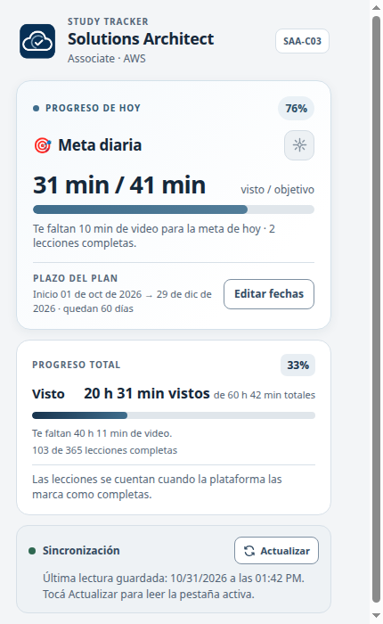
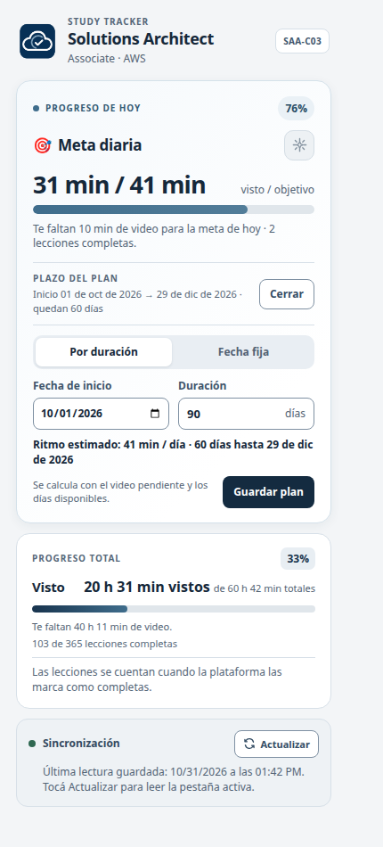

# AWS SAA Study Tracker

Extensión de Chrome para planificar y seguir el curso **AWS Certified Solutions Architect – Associate (SAA-C03)** de Adrian Cantrill.

La extensión convierte la duración de las lecciones completadas en progreso diario y total. El avance se acredita cuando la plataforma marca una lección como completa; no intenta medir el tiempo parcial del reproductor.

## Interfaz

La ventana reúne la meta del día, el avance acumulado del curso, el plazo elegido y el estado de sincronización.

<p align="center">
  
</p>
<p align="center"><sub>Vista de ejemplo con datos ilustrativos.</sub></p>

El plan permite definir una cantidad de días desde la fecha de inicio o una fecha final fija. La vista previa calcula el ritmo diario con el video pendiente.

<p align="center">
  
</p>
<p align="center"><sub>Editor de fechas y vista previa del ritmo diario.</sub></p>

## Funciones

- Meta diaria en minutos, con barra y porcentaje.
- Progreso total por duración: tiempo visto, tiempo pendiente y porcentaje del curso.
- Plan ajustable por duración o fecha final, con ritmo diario estimado.
- Sincronización automática al detectar cambios en la lista de lecciones y botón **Actualizar** para volver a leerla a pedido.
- Confeti al alcanzar la meta diaria y un estallido más grande con mensaje de racha por cada video adicional; el botón de confeti también se habilita al llegar al 100 % y cada toque agrega otro estallido.
- Porcentaje diario en el badge del ícono de Chrome.
- Progreso guardado en el almacenamiento local de Chrome.

Los iconos de meta y confeti usan trazados SVG de [Lucide](https://lucide.dev), recoloreados con la paleta de la extensión. Se incluyen inline en el popup, así que Chrome no carga ninguna librería JavaScript externa. `lucide-static` está en las dependencias de desarrollo para consultar o actualizar esos recursos; los avisos de licencia están en [THIRD_PARTY_NOTICES.md](THIRD_PARTY_NOTICES.md).

## Instalación en modo desarrollador

Para cargar la extensión no hace falta compilar ni instalar dependencias.

1. Cloná este repositorio o descargá el código fuente.
2. Abrí `chrome://extensions` en Chrome y activá **Modo de desarrollador**.
3. Elegí **Cargar extensión sin empaquetar** y seleccioná la carpeta del proyecto.
4. Iniciá sesión en el curso y abrí una lección del SAA-C03 en [learn.cantrill.io](https://learn.cantrill.io/courses/1820301/lectures/41301626).
5. Abrí el ícono de **AWS SAA Study Tracker** para consultar el progreso y configurar las fechas.

Al actualizar los archivos, recargá la extensión desde `chrome://extensions` y también la pestaña del curso. La pestaña necesita cargar el content script de la versión nueva.

## Uso

1. Abrí una lección del curso SAA-C03. La extensión lee el menú de lecciones y guarda el estado que informa la plataforma.
2. En el popup, revisá cuánto completaste hoy, cuánto te falta para la meta y el progreso total del curso.
3. En **Editar fechas**, indicá cuándo empezaste y elegí una duración o una fecha final. La vista previa muestra el ritmo diario necesario antes de guardar.
4. Completá las lecciones en la plataforma. Al pulsar **Complete and Continue**, el tracker identifica la lección de la URL y confirma el avance cuando abre la siguiente; también vuelve a leer el sidebar cuando la plataforma actualiza su estado.
5. Usá **Actualizar** si querés forzar una lectura de la pestaña activa.

El badge de Chrome muestra el porcentaje de la meta diaria. El popup conserva el detalle en minutos y horas.

Si querés actualizar los iconos desde Lucide, instalá las dependencias de desarrollo con `npm ci`; la extensión publicada no carga ni necesita `node_modules`.

## Cómo se calcula

- La meta diaria se calcula con el video pendiente y los días que quedan hasta la fecha final. El día de inicio cuenta como el primer día del plan.
- Durante el día, la cuota se mantiene estable mientras el progreso suma las lecciones completadas ese día; el ritmo se vuelve a calcular al cambiar el día.
- El progreso total usa la duración de los videos, no el conteo de elementos. Cuestionarios y avisos sin duración aparecen en el número de lecciones, pero no suman tiempo.
- Una lección cuenta solo cuando la plataforma la marca como completa. No se contabilizan avances parciales ni minutos reproducidos sin completar la lección.
- La extensión incluye un catálogo inicial de 365 elementos del sidebar, con 340 duraciones que suman **60 h 42 min**. El botón **Actualizar** permite refrescarlo con el contenido actual de la página.

## Privacidad y permisos

El progreso y las fechas se guardan localmente en `chrome.storage.local`. La extensión no envía datos a servicios externos ni solicita credenciales del curso. El content script lee el sidebar de lecciones en páginas de `learn.cantrill.io` y envía ese catálogo al service worker de la extensión para guardar el progreso.

El manifiesto declara estos permisos:

- `storage`: guardar el catálogo y el plan en el perfil local de Chrome.
- `activeTab`: consultar la pestaña activa cuando se solicita una actualización manual.
- Acceso a `https://learn.cantrill.io/courses/*`: ejecutar el lector del sidebar en páginas del curso.

## Diagnóstico

- Si **Actualizar** avisa que no hay respuesta, recargá la pestaña del curso. Esto también es necesario después de recargar o actualizar la extensión.
- Para ver los logs del popup: clic derecho sobre el popup → **Inspeccionar** → **Console**.
- Para ver los logs de la página, abrí DevTools en la lección y filtrá la consola por `[AWS SAA Tracker]`.
- Al pulsar **Complete and Continue**, buscá `Se pulsó el control de completar lección` en la página y `Clic de completar recibido` en el service worker. Cuando abre la lección siguiente, `Avance confirmado al abrir la siguiente lección` indica el ID registrado.
- Para revisar el almacenamiento y los errores del service worker, abrí los detalles de la extensión en `chrome://extensions` y elegí **Inspeccionar** en el service worker.
- El lector procesa el curso SAA-C03 con ID `1820301`. Si Adrian Cantrill cambia la estructura del sidebar, puede ser necesario actualizar los selectores de `content.js`.

## Estructura del proyecto

```text
├── assets/
│   ├── course-data.json       # Catálogo inicial de secciones y lecciones
│   └── study-tracker-icon.png # Ícono de la extensión
├── docs/screenshots/          # Capturas del popup para este README
├── .gitignore                 # Excluye dependencias instaladas localmente
├── background.js              # Persistencia, cálculos y badge
├── content.js                 # Lectura del sidebar y sincronización
├── manifest.json              # Configuración de Chrome MV3
├── package.json               # Fuente de desarrollo para iconos Lucide
├── popup.css                  # Estilos del popup
├── popup.html                 # Estructura de la interfaz
├── popup.js                   # Plan, métricas y eventos del popup
└── THIRD_PARTY_NOTICES.md     # Licencias de los iconos Lucide
```
